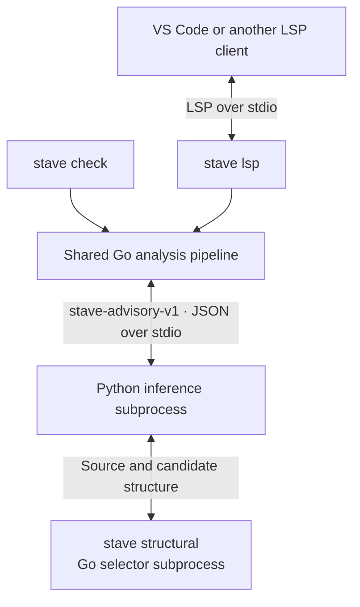

# Architecture

STAVE has three main components: a Go executable, a Python inference runtime and a VS Code extension. The command line
and editor share the same analysis pipeline. Analysis runs locally without network access.

## Components



Each command runs the shared pipeline within its own Go process. The Python runtime starts `stave structural` as a
separate process of the same `stave` binary to select candidates and extract their structure. The shared analysis
pipeline accesses the runtime through `advisory.Provider` in `internal/advisory`.

| Component | Location | Responsibility |
| --- | --- | --- |
| Commands | `cmd/stave` | Commands, installation management and model selection. |
| Analysis pipeline | `internal/harness`, `internal/pkgsnap`, `internal/analyzer`, `internal/instance`, `internal/diag` | Snapshot saved packages, run exact checks and combine findings with coverage information. |
| Language server | `internal/lsp` | Adapt analysis results to editor diagnostics and status updates. |
| Structural selector | `internal/structural`, `internal/tfcand`, `internal/tfsentry` | Select candidates and extract the structure used by the inference runtime. |
| Installation/configuration | `internal/app`, `internal/models`, `internal/runtime` | Configuration, model bundles and the Python environment installed from the embedded payload. |
| Inference runtime | `infer/src/stave_infer` | Load a bundle, tokenize source, run inference and return advisory findings. |
| VS Code extension | `editors/vscode` | Start the language server and display diagnostics, status and logs. |

## Analysis flow

1. Read a snapshot of the saved package and run exact checks for P1, P2 and P3.
2. Send the target file paths and source hashes to the advisory provider. The Python runtime loads the selected model
   and uses the selector to prepare candidates for inference.
3. Validate the response against the source hashes and required package context, then add advisory findings to the
   report. Exact findings remain available if inference is disabled or fails.

Coverage is reported for each target file, class and analysis type (`exact` or `advisory`):

| Status | Meaning |
| --- | --- |
| `checked` | The analysis completed within its supported scope; findings may or may not be present. |
| `unsupported` | The class or some of its candidates could not be judged. |
| `disabled` | Advisory analysis did not run. |
| `error` | Analysis failed for the class or some of its candidates. |

Exact checks apply conservative rules. For example, P2 requires unaliased `errors` or `fmt` imports and no conflicting
declarations. A known exclusion is a checked negative for that rule; missing package evidence is `unsupported`.
Findings from candidates that were checked remain available when other candidates could not be judged.

The language server analyses files when they are opened or saved, and when sibling files change. It publishes exact
findings first and adds advisory findings when they arrive. Editing a buffer clears its diagnostics until it matches the
saved file again; results for an older document or package snapshot are discarded.

## Contracts

- **`stave-advisory-v1`** connects the analysis pipeline to the inference runtime. A request contains file paths and
  source hashes; the response contains predictions, coverage and model identity. Each exchange starts a fresh Python
  process.
- **`stave-report-v1`** is the shared package report, containing findings, source identities and coverage. `stave check
  -json` prints these reports; the language server converts them to LSP diagnostics and `stave/status` notifications.

Model bundles use [`stave-model-bundle-1`](docs/model-bundles.md). The VS Code extension communicates only with the
language server and does not manage models.

## Configuration and models

The data directory is selected by `STAVE_HOME`, or defaults to:

- macOS: `~/Library/Application Support/stave`
- Linux: `$XDG_DATA_HOME/stave`, or `~/.local/share/stave`
- Windows: `%LOCALAPPDATA%\stave`

It contains:

```text
config.json          Active model and analysis defaults
runtime/<version>/   Python environment for the installed STAVE version
models/<id>/         Installed model bundles
downloads/           Temporary bundle downloads
```

`stave setup` preserves a valid active model and selects one when needed. Use `stave model use` to change the active
model in `config.json`. Both `check` and `lsp` reload this choice before analysis, so a model change takes effect on
the next `check` run or editor save. The `-model ID` flag overrides it for one invocation.

`config.json` also holds `threads` (CPU thread count), `advisory_timeout` (default `180s`) and `tests` (whether to
analyse test files, default `true`).

If the model or runtime is unavailable, exact checks still run and coverage explains why advisory analysis is disabled.
Each bundle specifies its model variant: B uses the flat model, while F and S use the structural model.
